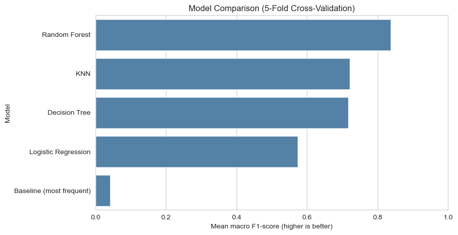
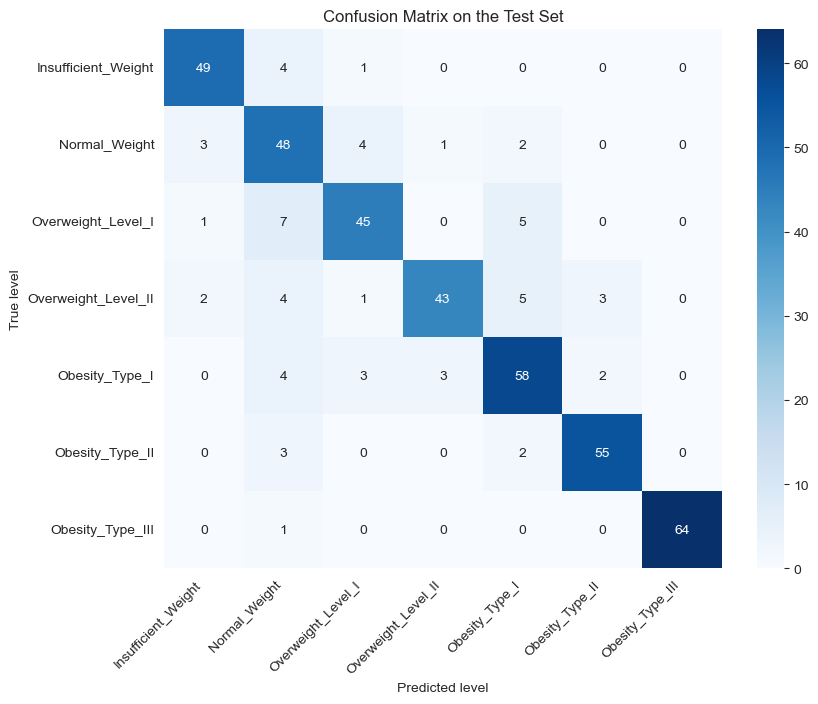
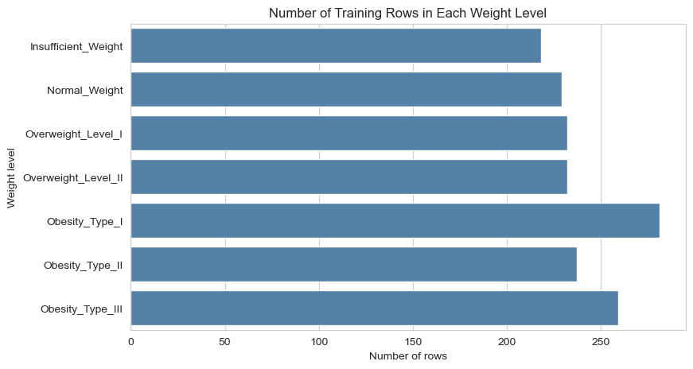
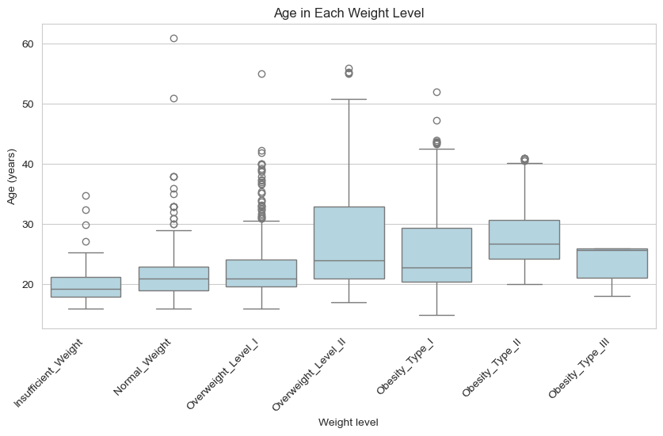
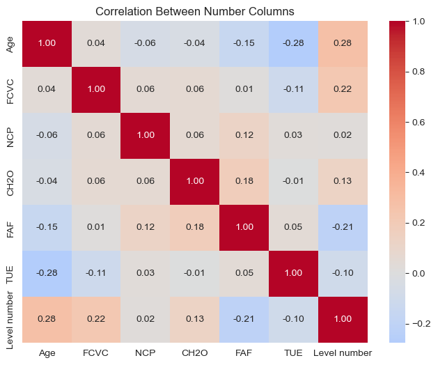
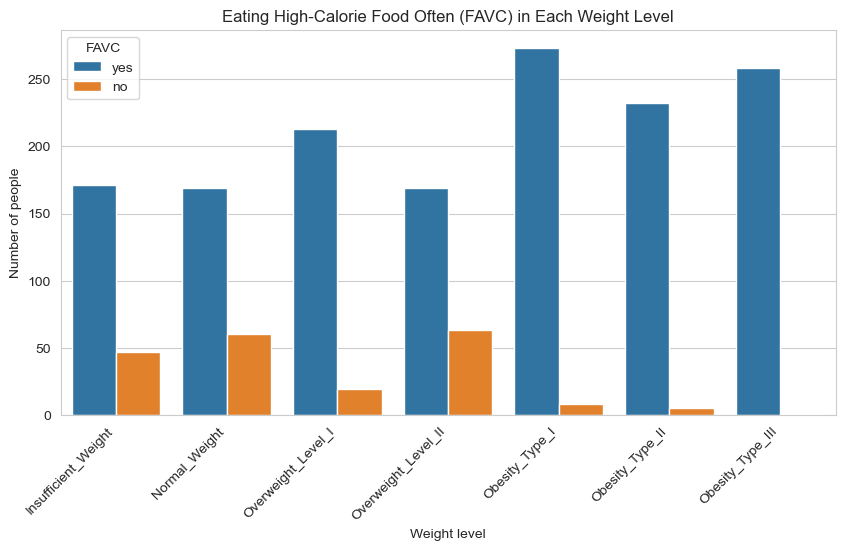
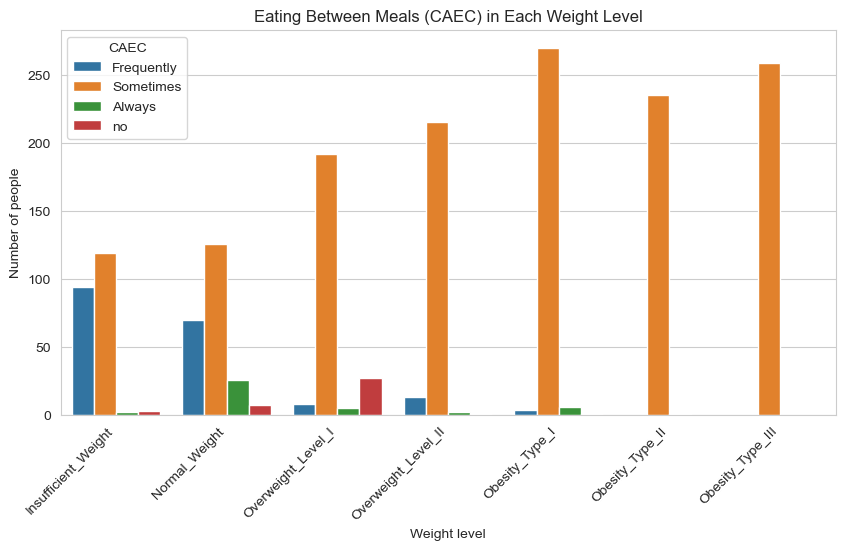

# Predicting Obesity Level from Eating Habits and Daily Life


A machine learning project (Lab 14 capstone) that guesses a person's **weight level** from their **eating habits and daily life**. It covers the whole path: data exploration, a leak-free pipeline, model comparison with cross-validation, tuning, a single final test, and error analysis.

## Results at a glance

| Item | Value |
|---|---|
| Task | Multi-class classification (7 weight levels) |
| Data | 2,111 rows, 16 input columns (14 after removing Height and Weight) |
| Metric | Macro F1-score (accuracy is shown as a second number) |
| Best model | Random Forest (tuned) |
| **Test macro F1** | **0.856** |
| **Test accuracy** | **0.856** |
| Baseline (always guess the most common class) | 0.041 macro F1 |

## The problem

Doctors work out a person's weight level from height and weight. This project asks a different question: **how well can eating habits and daily life alone tell the weight level?** Such a model could be a first, quick check, but it is **not** a medical tool.

## Dataset

- **Name:** Estimation of Obesity Levels Based on Eating Habits and Physical Condition
- **Source:** [UCI Machine Learning Repository, id 544](https://archive.ics.uci.edu/dataset/544/estimation+of+obesity+levels+based+on+eating+habits+and+physical+condition)
- **People:** from Mexico, Peru and Colombia
- **Target:** `NObesity`, with 7 classes: Insufficient Weight, Normal Weight, Overweight Level I, Overweight Level II, Obesity Type I, Obesity Type II, Obesity Type III
- **Missing values:** none

### Two important data decisions

1. **Height and Weight were removed.** The weight level is worked out from them (BMI). Keeping them would let the model copy the formula (target leakage) instead of learning from habits.
2. **About 77% of the rows were made by a computer** (SMOTE) from real survey answers; only about 23% are real answers. Near copies of a row can end up in both the training and the test set, so the scores may look better than they would on new real people. This is the main limitation of the project.

The data is not stored in this repository. See [`data/README.md`](data/README.md) to download it.

## Project structure

```
obesity-level-classification/
├── README.md                  <- this file
├── requirements.txt           <- Python libraries
├── setup_env.sh / setup_env.bat   <- create the virtual environment
├── LICENSE
├── data/                      <- put the dataset here (not committed)
│   └── README.md
├── notebooks/
│   └── obesity_level_classification.ipynb   <- full step-by-step work, with outputs
├── src/
│   ├── download_data.py       <- download the dataset from UCI
│   └── train.py               <- the whole pipeline as a script
├── reports/
│   ├── figures/               <- charts from the notebook
│   ├── classification_report.txt
│   └── metrics.json           <- final numbers from the notebook run
├── docs/
│   └── Project_Report.docx    <- written report
├── flyer/
│   └── linkedin_flyer.png     <- one-page summary graphic
└── models/                    <- trained model is saved here (not committed)
```

## How to run it

### 1. Create the virtual environment

**Windows**

```bat
setup_env.bat
.venv\Scripts\activate
```

**Linux / macOS / Git Bash**

```bash
bash setup_env.sh
source .venv/bin/activate
```

Or by hand:

```bash
python -m venv .venv
source .venv/bin/activate        # Windows: .venv\Scripts\activate
pip install -r requirements.txt
```

### 2. Get the data

```bash
python src/download_data.py
```

### 3. Run the notebook or the script

```bash
jupyter notebook notebooks/obesity_level_classification.ipynb
```

Open the notebook and run it from top to bottom. If your CSV file has a different name, change it in the "Load the Data" cell.

Or run everything as a script (saves the results in `reports/script_run/` and the model in `models/`):

```bash
python src/train.py
```

The random seed is fixed (`random_state=42`), so the split and the scores can be repeated.

## Method

1. **Lock away the test set first** (20%, stratified). It is not touched until the end.
2. **Explore the training data only:** missing values, class balance, five plots.
3. **Pipeline with no leakage:** missing values are filled, number columns are scaled, text columns are one-hot encoded, all inside a `Pipeline` and `ColumnTransformer`, so each cross-validation fold learns only from its own training part.
4. **Baseline and 4 models** compared with 5-fold stratified cross-validation: Logistic Regression, Decision Tree, Random Forest, KNN.
5. **Tune the best model** with `GridSearchCV`.
6. **Test one time** on the locked test set, then study the mistakes.

## Results

### Model comparison (5-fold cross-validation on the training set)

| Model | Mean macro F1 | Std |
|---|---|---|
| **Random Forest** | **0.837** | 0.013 |
| KNN | 0.721 | 0.021 |
| Decision Tree | 0.717 | 0.014 |
| Logistic Regression | 0.574 | 0.013 |
| Baseline (most frequent) | 0.041 | 0.000 |

Random Forest won, so it was tuned. The best settings were `max_depth=20`, `min_samples_split=2`, `n_estimators=100`, with a cross-validation macro F1 of 0.841.



### Final test (423 rows, used once)

| Weight level | Precision | Recall | F1 | Rows |
|---|---|---|---|---|
| Insufficient Weight | 0.891 | 0.907 | 0.899 | 54 |
| Normal Weight | 0.676 | 0.828 | 0.744 | 58 |
| Overweight Level I | 0.833 | 0.776 | 0.804 | 58 |
| Overweight Level II | 0.915 | 0.741 | 0.819 | 58 |
| Obesity Type I | 0.806 | 0.829 | 0.817 | 70 |
| Obesity Type II | 0.917 | 0.917 | 0.917 | 60 |
| Obesity Type III | 1.000 | 0.985 | 0.992 | 65 |
| **Macro average** | **0.862** | **0.855** | **0.856** | 423 |



### Error analysis

- The model made **61 wrong predictions out of 423 (14.4%)**.
- **50.8%** of the mistakes were only one level away from the true level; 18 were two levels away, and 12 were three or more levels away.
- The most mixed-up pairs were Overweight Level I predicted as Normal Weight (7 times), and Overweight Level II predicted as Obesity Type I (5 times).
- Obesity Type III is almost perfect (F1 0.992), while Normal Weight is the weakest (precision 0.676).

Weight levels sit on one scale and the borders between them are not sharp, so many mistakes are a neighbouring level. Since Height and Weight were removed, two people with the same habits can still have different body sizes.

### Data exploration

| | |
|---|---|
|  |  |
|  |  |



## Limitations and ethics

- **Mostly computer-made data (about 77%).** Scores may be higher than on new real people. A good next test is to train and test on real survey rows only.
- **Three countries only, and self-reported answers.** The model may not work for other places, ages or food cultures.
- **Not a diagnosis.** Weight and health data are private and must not be used to shame people, or to refuse a job or an insurance plan.
- **Group fairness was not checked.** Scores were not compared for men and women or for different age groups.
- **Small dataset.** With 2,111 rows, scores can change with a different random split.

## Future work

- Train and test on real survey rows only, and compare the scores.
- Check scores separately for men and women and for age groups.
- Try more models and feature importance to see which habits matter most.
- Collect more real data from more countries.

## Documents

- [`docs/Project_Report.docx`](docs/Project_Report.docx): written report
- [`flyer/linkedin_flyer.png`](flyer/linkedin_flyer.png): one-page summary

## Data citation

Palechor, F. M., & de la Hoz Manotas, A. (2019). *Dataset for estimation of obesity levels based on eating habits and physical condition in individuals from Colombia, Peru and Mexico.* Data in Brief, 25, 104344. Please check the dataset page for the current citation and license terms.

## Author

**Your Name** · MS Data Science · [LinkedIn](https://www.linkedin.com/in/your-profile) · [GitHub](https://github.com/your-username)

## License

The code is released under the MIT License (see `LICENSE`). The dataset has its own terms, listed on the UCI page.
